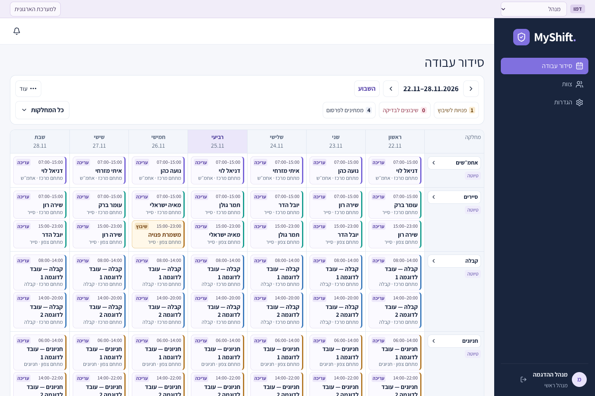

# MyShift · ניהול סידורי עבודה

מערכת לניהול משמרות בעברית וב־RTL. מנהלים בונים ומפרסמים סידורי עבודה לפי מחלקה, ועובדים רואים את השיבוצים האישיים שלהם לאחר פרסום.

[הרצת הדגמה](#הרצה-מקומית) · [חיבור ארגון](#חיבור-ארגון-לsupabase) · [בדיקות](#בדיקות)



*סידור עבודה הוא המסך הראשי למנהל. הוא מציג את השבוע לפי מחלקה ומאפשר לפתוח משמרת בטיוטה לעריכה ישירות מהלוח.*

דף הבית מציג 56 משמרות דוגמה לשבוע מלא באחמ״שים, סיירים, קבלה וחניונים. במסך רחב רואים את השבוע במבט אחד, ובמסך צר בוחרים יום ורואים את כל האזורים יחד.

[צילום הלוח במחשב](docs/screenshots/home-schedule-desktop.png) · [צילום הלוח בטלפון](docs/screenshots/home-schedule-mobile.png)

בכניסה לדמו כמנהל, הלוח השבועי מציג 49 משמרות דוגמה בארבע המחלקות, ובהן משמרת פתוחה אחת בסיירים לתרגול שיבוץ. דמו שכבר נשמר בדפדפן מקבל פעם אחת את סידורי הדוגמה החסרים לקבלה ולחניונים בשבוע שמוצג בכניסה. [צילום לוח הדמו בטלפון](docs/screenshots/roster-mobile.png).

## מה אפשר לעשות במערכת

| מסך | שימוש |
| --- | --- |
| **סידור עבודה** | לראות את השיבוצים בכל המחלקות ולסנן לפנויות, לשיבוצים לבדיקה או לטיוטות שממתינות לפרסום. בטלפון בוחרים יום, ואפשר להתמקד במחלקה באמצעות חיפוש. |
| **סידור מחלקה** | לעבור בין מחלקות, ליצור ולהשלים טיוטה, לשבץ ולפרסם. ״עוד״ כולל פעולות שבוע, קבצים וסל מחזור. ״חזרה לכל המחלקות״ שומרת את היום, הסינון והמיקום בלוח. |
| **צוות** | לנהל עובדים, שיוכים והכשרות, ולדווח זמינות והיעדרויות בהתאם להרשאות. תלושים ותזכורות מופיעים בצוות בדמו. |
| **הגדרות** | להגדיר מחלקות, אתרים, שעות ודרישות איוש, ולראות את יומן הפעילות. |
| **המשמרות שלי** | לראות את המשמרת הקרובה ואת השיבוצים האישיים שפורסמו. דיווחי זמינות והיעדרות זמינים ב״הפרופיל שלי״. |

לשינוי עובד, פותחים משמרת בטיוטה, בוחרים עובד ושומרים. לעריכת תאריך, שעות, אתר ותפקיד פותחים את ״פרטי משמרת״ באותו חלון. לאחר השמירה אפשר לבטל את הפעולה האחרונה. [צילום עורך המשמרת בטלפון](docs/screenshots/shift-editor-mobile.png)

השיבוץ האוטומטי בודק זמינות, הכשרות וחפיפות. אפשר לייבא CSV או XLSX עם תצוגה מקדימה, לייצא ל־Excel ולהדפיס את הלוח השבועי המלא ל־PDF.

## הרצה מקומית

מתיקיית המאגר, עם Node.js 24 ו־npm 11:

```sh
npm ci
npm run dev
```

פתחו את [הדמו המקומי](http://localhost:3000/demo) כדי להתנסות עם 12 עובדים לדוגמה בארבע מחלקות ובשני אתרים. אפשר לשנות שיבוצים, לפרסם סידור ולבחור עובד בפס **דמו** שמעל לאפליקציה. השינויים נשמרים ב־`localStorage` של הדפדפן תחת `myshift.demo.v1`. הדמו זמין ללא התחברות, מפתחות או מסד נתונים.


*מסך תלושים ותזכורות זמין בדמו. אפשר להתנסות בשליחת תלוש לדוגמה לתיבה האישית של עובד בדמו ולראות תזכורות לימי הולדת.*

## חיבור ארגון ל־Supabase

1. העתיקו את [קובץ ההגדרות לדוגמה](.env.example) באמצעות `cp .env.example .env.local`. הגדירו את `NEXT_PUBLIC_SUPABASE_URL` ואת `NEXT_PUBLIC_SUPABASE_ANON_KEY` עם כתובת הפרויקט והמפתח הציבורי שלו.
2. הריצו את [המיגרציות](supabase/migrations) לפי הסדר, מ־001 עד 009. אפשר להוסיף את [נתוני ההתחלה](supabase/seed.sql) אם נדרשות מחלקות ותבניות לדוגמה.
3. צרו משתמש ב־Supabase Auth והגדירו אותו כמנהל ראשי ב־SQL Editor. החליפו את הערך ב־UUID של המשתמש שיצרתם.

   ```sql
   update public.profiles
   set role = 'admin', name = 'מנהל מערכת'
   where id = 'UUID-OF-THE-CREATED-AUTH-USER';
   ```

4. הפעילו מחדש את שרת הפיתוח והיכנסו ל־[מערכת הארגון](http://localhost:3000/app). אם הארגון ריק, הגדירו את האתר הראשון והמשיכו להגדרת מחלקות, עובדים ותבניות.

מנהל ראשי מנהל שיוכים והרשאות. מנהל מחלקה פועל במחלקות שהוקצו לו. עובדים רואים את השיבוצים האישיים שפורסמו. Supabase Auth מזהה את המשתמש, ומדיניות RLS ופעולות המסד אוכפות את ההרשאות.

### פריסה ב־Vercel

ייבאו את המאגר כפרויקט Next.js והגדירו Node.js 24. פקודות ההתקנה והבנייה מוגדרות ב־[vercel.json](vercel.json). הוסיפו את משתני Supabase בסביבות הפריסה הרצויות והגדירו ב־Supabase Auth את כתובת האתר ואת כתובות ההפניה המתאימות.

לאחר החיבור, בדקו כניסה לפי תפקיד, יצירה ופרסום של סידור, דחיית חפיפות ושמירת השינויים מדפדפן נוסף.

## בדיקות

```sh
npm run lint
npm run typecheck
npm test
npm run build
npx playwright install chromium
npm run test:e2e
npm run test:e2e:flows
```

בדיקות PGlite מריצות את המיגרציות ובודקות הרשאות, שיבוץ ופעולות מסד. בדיקות Playwright מכסות את הדמו ואת מסלול הארגון מול מסד בדיקה מקומי. חיבור Supabase של הארגון נבדק בנפרד לאחר ההגדרה.

## מבנה המאגר

- [src/app](src/app) כולל את מסכי הפתיחה, הדמו, הארגון וההגדרה, ואת נתיבי ה־API.
- [src/components](src/components) כולל את ממשק לוחות העבודה ואת מסכי ניהול העובדים.
- [src/lib](src/lib) כולל את מודל ההדגמה, לוגיקת המשמרות וחיבורי השירותים.
- [supabase/migrations](supabase/migrations), [tests](tests) ו־[e2e](e2e) כוללים את סכמת המסד ואת הבדיקות.
