# MyShift

מערכת ניהול משמרות בעברית ובכיוון RTL. מנהלים בונים סידור מחלקתי, בודקים שיבוצים ומפרסמים אותם. עובדים רואים את המשמרות האישיות שפורסמו ומדווחים על זמינות והיעדרויות.

[הרצה מקומית](#quick-start) · [תרגול בדמו](#demo) · [סידור עבודה](#scheduling) · [צוות ועובדים](#team) · [הגדרות](#settings) · [חיבור ארגון](#organization) · [בדיקות וקוד](#checks)


## מה נחסך בעבודה היומיומית

| פעולה | מה MyShift מרכזת | מה זה חוסך |
| --- | --- | --- |
| הכנת סידור | תבניות, דרישות איוש והצעה שבועית לכמה מחלקות בפעולה אחת | הזנה חוזרת של שעות ומשמרות והעתקה בין גיליונות |
| בדיקת שיבוצים | זמינות, הכשרה, היעדרויות, חפיפות וזמן מנוחה נבדקים לפני שמירה ופרסום | הצלבה ידנית של דיווחים וסידורים בין מחלקות |
| עדכון סידור שכבר פורסם | טיוטה נפרדת לעבודה וסקירה מול הפרסום הקודם | השוואה ידנית בין גרסאות ואי־בהירות לגבי הסידור שהעובדים רואים |
| שינויים ותקלות | סימוני יום, הסבר בכרטיס המשמרת, ביטול פעולה אחרונה וסל מחזור | מעבר על כל הלוח כדי לאתר בעיה ובנייה מחדש אחרי שגיאת עריכה |
| מסירת הסידור | תצוגה אישית לעובד, התראות בתוך המערכת, ייצוא Excel והדפסה | הכנת עותק ידנית לכל עובד והפצה חוזרת של אותו קובץ |

<a id="quick-start"></a>

## הרצה מקומית

נדרשים Git, ‏Node.js 24 ו־npm 11. משכפלים את המאגר ומפעילים את שרת הפיתוח.

```sh
git clone https://github.com/Benjamin-1Fisher/MyShift.git
cd MyShift
npm ci
npm run dev
```

| כתובת | מה עושים בה |
| --- | --- |
| [דף הבית](http://localhost:3000/) | בוחרים יום בתצוגה לדוגמה או עוברים לדמו או לארגון |
| [דמו](http://localhost:3000/demo) | מתרגלים כמנהל או כעובד עם ארבע מחלקות, שני אתרים ו־12 עובדים לדוגמה |
| [מערכת ארגונית](http://localhost:3000/app) | מתחברים עם חשבון שהוזמן לארגון והוגדר ב־Supabase |
| [הקמת ארגון](http://localhost:3000/setup) | פותחים את מסך ההנחיות לחיבור מסד ולפריסה |

הדמו זמין מיד, ללא חשבון או קובץ הגדרות. אם פורט 3000 תפוס, השתמשו בכתובת שהשרת הדפיס במסוף. [דף הבית במחשב](docs/screenshots/home-schedule-desktop.png) · [דף הבית בטלפון](docs/screenshots/home-schedule-mobile.png)

<a id="demo"></a>

## תרגול בדמו

1. פתחו דמו חדש או בחרו **איפוס** בפס העליון, ואז בחרו **מנהל**. השבוע מתחיל עם שלוש משמרות פנויות בקבלה, בחניונים ובסיירים, וגם עם משמרות חסרות לפי דרישות האיוש.
2. לחצו **תכנון שבועי** והשאירו את ברירת המחדל של כל המחלקות. ההצעה מציגה עובדים זמינים למילוי המשמרות הפנויות ומשמרות חדשות להשלמת הכיסוי.
3. לחצו **אישור ושמירה כטיוטה**. בתרחיש ההתחלתי מונה המשמרות הפנויות יורד מ־3 ל־0 והשיבוצים שכבר נקבעו נשמרים. אפשר לבחור **ביטול הפעולה האחרונה** בהודעת השמירה.
4. לחצו **סקירה ופרסום**, בדקו את השינויים, בחרו את המחלקות ואשרו. עברו לתצוגת אחד העובדים ששובצו כדי לראות את הסידור האישי. לפרסום לדוגמה שכבר קיים, בחרו **דניאל לוי** ועברו שבוע אחד אחורה.

[כך נראה הסידור לאחר התכנון השבועי](docs/screenshots/roster-after-planning.png)

**איפוס** בפס הדמו פותח מסך אישור. אישור מוחק את השינויים המקומיים בדמו, כולל תלושי הדוגמה, ומחזיר את נתוני ההתחלה, השבוע הנוכחי ותצוגת המנהל בלשוניות דמו פתוחות. הדמו שומר נתונים בדפדפן באמצעות `localStorage`. [מסך אישור האיפוס](docs/screenshots/demo-reset-mobile.png)

<a id="scheduling"></a>

## סידור עבודה למנהלים

### הלוח השבועי

- במחשב רואים את כל המחלקות ושבעת ימי השבוע בטבלה. בטלפון בוחרים יום ורואים את משמרותיו לפי מחלקה. החצים עוברים בין שבועות וכפתור **השבוע** חוזר לשבוע הנוכחי.
- בוחרים מחלקה או את כולן. מסנני **הכול**, **פנויות**, **לבדיקה** ו־**טיוטות** משנים את התצוגה ומציגים את ההיקף הפעיל. הספירה של טיוטות היא לפי מחלקות. אם אין תוצאות ביום הנבחר, הלוח יכול להציע מעבר ליום קרוב עם תוצאות.
- סימון קטן ליד יום מציין משמרת פנויה או שיבוץ לבדיקה. כרטיס משמרת מסביר את הסיבה, למשל עובד שאינו זמין או חפיפה. כשיש גרסה מפורסמת, הכרטיס מציג גם שינויים הממתינים לפרסום מול מה שהעובדים רואים.
- לחצו **לסידור המחלקה** לניהול מפורט. **חזרה לכל המחלקות** מחזירה את היום, המסננים ומיקום הגלילה.

| הלוח בטלפון | שינוי ובעיית שיבוץ |
| :---: | :---: |
| 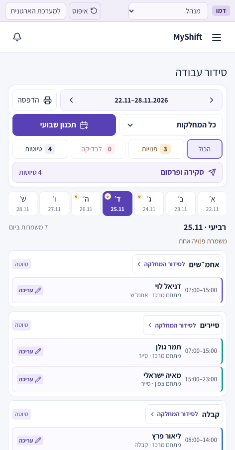 | 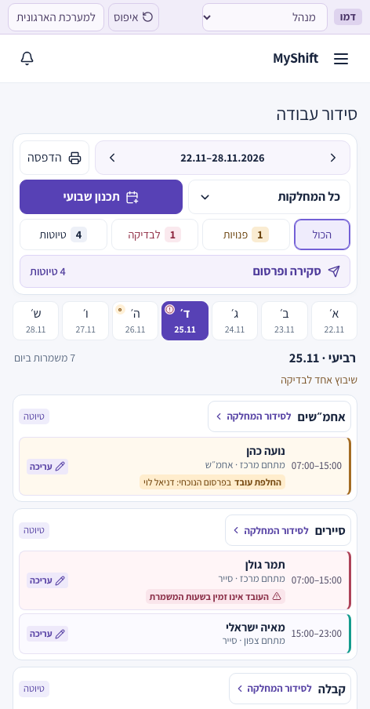 |

### מתכנון ועד פרסום

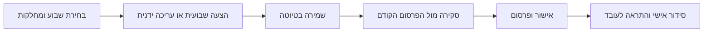

1. **תכנון שבועי** מתחיל מכל המחלקות שבניהולכם. אפשר לבחור מחלקה אחת במקום כולן. פתחו שורת מחלקה כדי לראות את ההצעות או את הסיבה שאין הצעה, למשל שעות שטרם אומתו.
2. **אישור ושמירה כטיוטה** שומר את ההצעות יחד. המתכנן מוסיף משמרות נדרשות ומנסה למלא משמרות פנויות תוך שמירה על השיבוצים הקיימים. אם הסידור השתנה מאז שנפתחה ההצעה, רעננו את ההצעה לפני אישור.
3. **סקירה ופרסום** פותח את **סקירה ופרסום סידור**. פתחו **פירוט** ליד מחלקה כדי להשוות לפרסום הקודם. המחלקות שאפשר לפרסם מסומנות מראש ואפשר לבטל את בחירתן. משמרות פנויות מוצגות בסיכום. אם מופיעה הודעת **דורש תיקון לפני פרסום**, תקנו את השיבוץ וחזרו לסקירה. ירוק מסמן משמרת חדשה, כחול מסמן מילוי משמרת פנויה, גוון ענברי מסמן עריכה או החלפת עובד, ואדום מסמן הסרה או בעיית שיבוץ.
4. **אישור ופרסום** מעדכן את הסידור לעובדים במחלקות שנבחרו. **פתיחה לעריכה** משאירה לעובדים את הפרסום האחרון בזמן שהמנהלים מכינים עדכון. רק הפרסום הבא מחליף אותו.

| הצעת תכנון לפי מחלקה | סקירה ואישור פרסום |
| :---: | :---: |
| 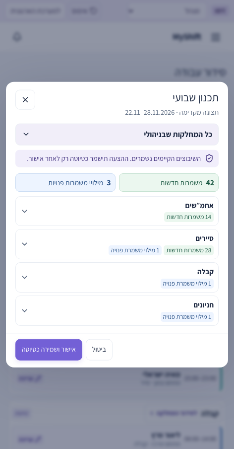 | 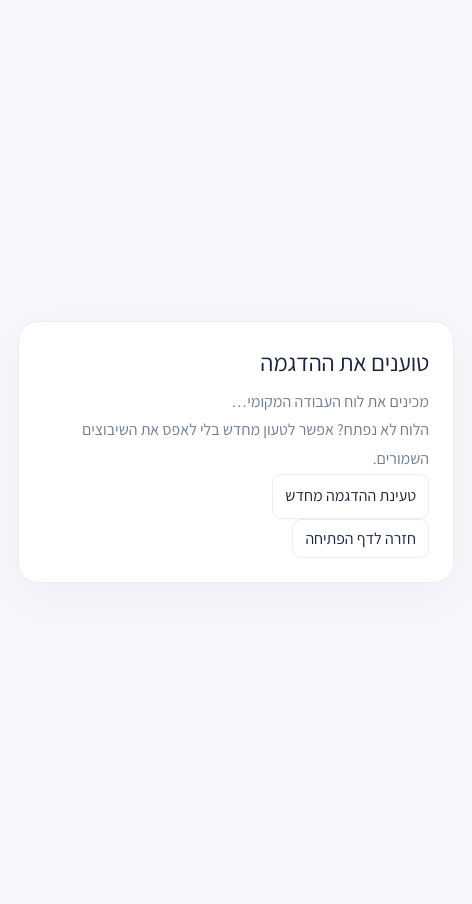 |

### עריכה ותפעול במחלקה

- **הוספת משמרת** פותחת טופס למחלקה הנבחרת. בוחרים יום, תבנית שעות מאומתת או **שעות מותאמות**, אתר ותפקיד. אפשר לשבץ עובד או להשאיר משמרת פנויה. משמרת לילה יכולה להסתיים ביום הבא.
- לחצו על משמרת בטיוטה כדי לראות מי משובץ, להחליף עובד או לפתוח **פרטי משמרת** ולשנות את הזמנים. **יצירת משמרת דומה** מעתיקה שעות, אתר ותפקיד לטופס חדש ומשאירה את בחירת העובד פתוחה. בוחרים יום ושומרים כדי ליצור את המשמרת החדשה.
- **מחיקה** דורשת אישור ומשפיעה על המשמרת הבודדת. **ביטול הפעולה האחרונה** זמין מהודעת השמירה כשגרסת הטיוטה מאפשרת זאת.
- **סינון ותצוגות נוספות** מאפשר לסנן לפי עובד ואתר ולעבור בין שבוע, חודש ותצוגה לפי עובד. בטיוטה אפשר לבחור **החלפה** ולבחור שתי משמרות להחלפת העובדים. כדי להעביר משמרת ליום אחר בשבוע, בחרו יום אחר ב־**פרטי משמרת**.
- הפעולה הראשית משתנה לפי מצב המחלקה. דרך **עוד** אפשר להשלים משמרות, ליצור משמרות פנויות, למלא משמרות אוטומטית, להעתיק את השבוע הקודם לשבוע ריק או לנקות שיבוצים תוך שמירה על המשמרות.
- להעברת שבוע מחלקתי לארכיון בחרו **עוד ← העברה לסל המחזור** ואשרו. **שחזור סידור** מחזיר אותו כטיוטה. כשיש סידור פעיל, שחזור סידור אחר מעביר את הפעיל לסל המחזור. אם סידור פורסם והועבר לסל המחזור, הוא מוסר מתצוגת העובדים עד לשחזור ולפרסום.

| סידור מחלקה | עורך משמרת | בוררי שעות מותאמות |
| :---: | :---: | :---: |
| 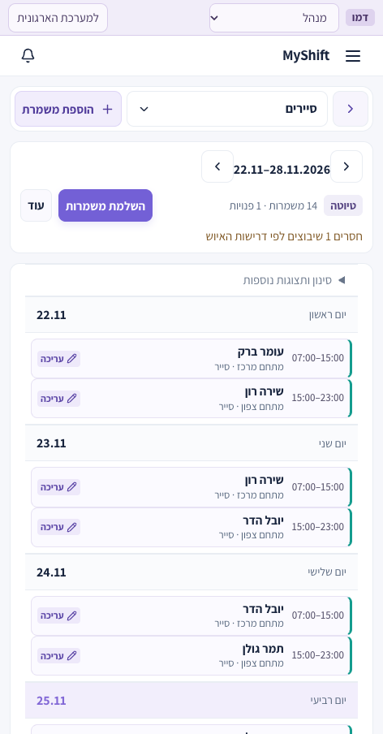 | 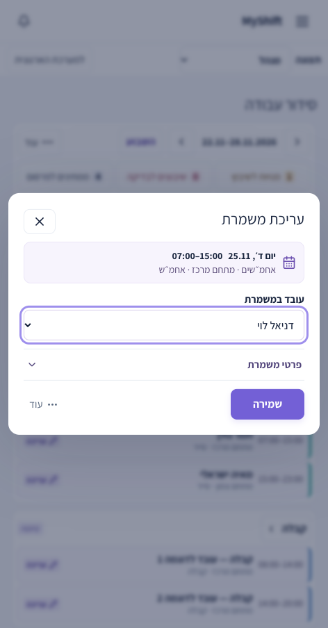 | 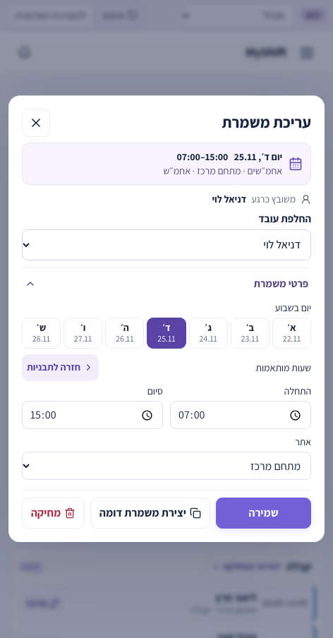 |

### הדפסה וקבצים

| פעולה | איפה | מה מקבלים |
| --- | --- | --- |
| הדפסה או PDF | **הדפסה** בלוח השבועי או **עוד ← הדפסה** במחלקה | הדפסה של הלוח הראשי כוללת את כל השבוע והמחלקות. לשמירת PDF בוחרים את האפשרות בחלון ההדפסה של הדפדפן |
| ייצוא Excel | **סידור מחלקה ← עוד ← ייצוא Excel** | קובץ `.xlsx` של השיבוצים המסוננים בשבוע הנבחר, עם שעות, תאריך סיום ומזהי המערכת |
| ייבוא CSV או Excel | **סידור מחלקה בטיוטה ← עוד ← ייבוא** | הוספת משמרות אחרי מיפוי עמודות, בדיקת הקובץ, תצוגה מקדימה ואישור אחד |

לייבוא השתמשו בשורת כותרות ובעד 100 שורות נתונים, עד 2MB. ב־Excel קוראים את הגיליון הראשון, עד 50 עמודות, וממירים נוסחאות לערכים לפני ההעלאה. ממפים את `department_id`, `site_id`, `role_id`, `employee_id`, `date`, `start` ו־`end`. התאריך הוא בפורמט `YYYY-MM-DD` והשעות בפורמט `HH:mm`. השאירו את `employee_id` ריק למשמרת פנויה. עמודות המזהים מייצוא Excel מסייעות בהכנת הקובץ.

<a id="team"></a>

## צוות, זמינות ותצוגת עובד

### מסך צוות

- בחרו מחלקה, חפשו לפי שם או סננו לפי תפקיד, מיקום או היעדרות בשבוע. **איפוס סינון** מחזיר לרשימת המחלקה.
- מנהל ראשי בוחר **עובד חדש** ומזין שם, מחלקה, תפקיד ומצב פעילות. **עריכה** משנה את הכרטיס ו־**הכשרה** משייכת עובד קיים לתפקיד ולמחלקה. בארגון, חיבור למשתמש נעשה בשדה **מזהה משתמש** בכרטיס העובד.
- בעת יצירה או עריכה, **זמינות קבועה למשמרות** מאפשרת לבחור בוקר, ערב ולילה לפי יום או להשתמש בבחירות מהירות לכל השבוע. הבחירה חוזרת מדי שבוע, ומשמרת לילה שייכת ליום שבו היא מתחילה.
- **דיווח זמינות** מוסיף חלון שעות לתאריך מסוים. **חופשות והיעדרויות** מוסיף דיווח לפי סוג וימים, כולל יום הסיום. באזור **זמינות והיעדרויות בשבוע הנבחר** אפשר לעבור בין שבועות, לערוך חלון זמינות ולעדכן או לבטל היעדרות לפי הרשאה.
- עדכון זמינות או היעדרות משפיע על בדיקות השיבוץ. שיבוץ קיים שדורש טיפול מסומן לבדיקה.

| ניהול צוות | בחירת זמינות קבועה |
| :---: | :---: |
| 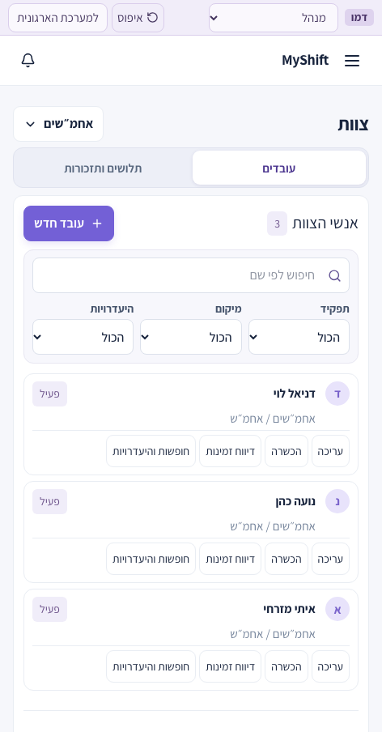 | 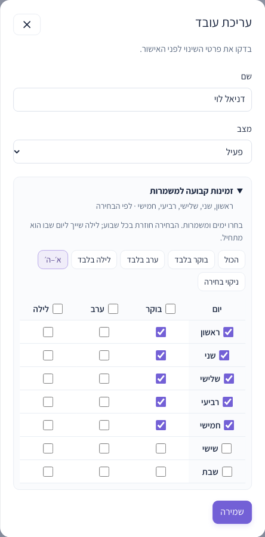 |

### מה העובד רואה

**המשמרות שלי** מציג את המשמרת הקרובה ואת השיבוצים האישיים מהסידור שפורסם. אפשר לעבור בין שבועות ולבחור תצוגה. **הפרופיל שלי** מציג את פרטי העובד ומאפשר לדווח על זמינות לתאריך מסוים ועל היעדרויות. העובד יכול לעדכן או לבטל את דיווחי ההיעדרות שלו בהתאם לאפשרויות שמוצגות.

[דיווח זמינות לתאריך מסוים](docs/screenshots/availability-mobile.png) · [דיווח היעדרות](docs/screenshots/absence-mobile.png)

לחצו על הפעמון כדי לראות מה פורסם, עודכן או הוסר. **פירוט** פותח את סיכום ההתראה ומסמן אותה כנקראה. **לסידור השבוע** פותח את השבוע והמחלקה הרלוונטיים. ההתראות מוצגות בתוך המערכת.

| סידור אישי | התראות סידור |
| :---: | :---: |
| 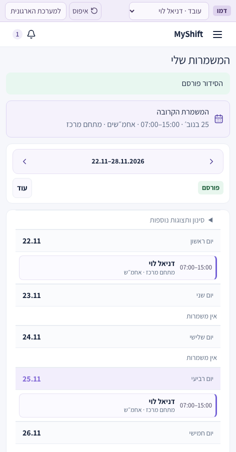 | 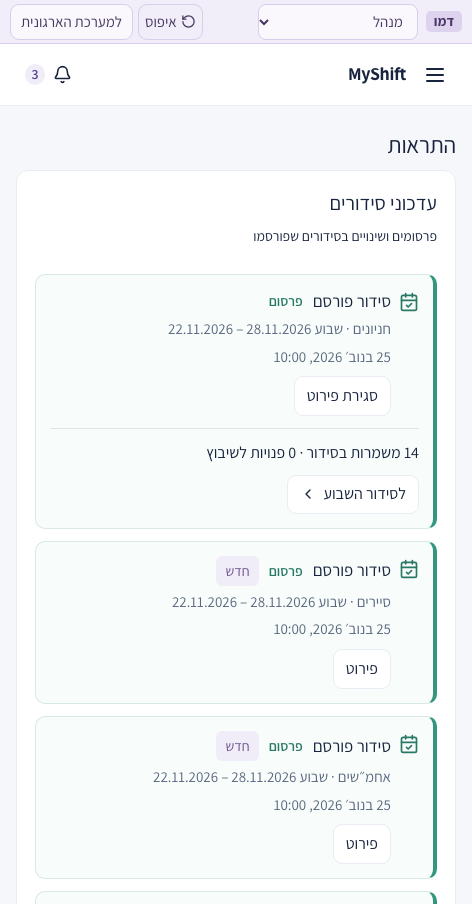 |

### תלושים וימי הולדת בדמו

ב־**צוות ← תלושים ותזכורות**, המנהל שולח תלוש דוגמה לעובד אחד או לכל מי שטרם קיבל תלוש לחודש. כדי לפתוח אותו, עברו לתצוגת העובד ובחרו **הפרופיל שלי ← התלושים שלי**. באותו מדור המנהל רואה ימי הולדת לדוגמה ל־30 הימים הקרובים. זהו תרגול מקומי עם נתונים פיקטיביים. [תלושים ותזכורות במחשב](docs/screenshots/team-desk.png)

<a id="settings"></a>

## הגדרות והרשאות

| מדור | מה מגדירים |
| --- | --- |
| **כללי סידור** | בוחרים מחלקה, מוסיפים תבניות שעות ומסמנים אותן כמאומתות כשהשעות ידועות. מוסיפים דרישת איוש לפי יום, אתר, תפקיד, שעות וכמות עובדים. אפשר לסנן את הדרישות לפי יום, אתר ותפקיד |
| **כללי מנוחה ושעות** | מנהל ראשי קובע זמני מנוחה מינימליים ומשך משמרת מרבי בהתאם לכללים התפעוליים של הארגון |
| **הרשאות** | מנהל ראשי מזין מזהה משתמש, בוחר תפקיד מערכת ומשייך מזהי מחלקות למנהל מחלקה |
| **מבנה הארגון** | מנהל ראשי יוצר ומעדכן מחלקות ואתרים, בוחר צבע למחלקה ומוסיף תפקידים. השבתת מחלקה שומרת את ההיסטוריה שלה |
| **יומן פעילות** | רואים עד 200 פעולות אחרונות בתחום ההרשאה ופותחים את פרטי השינוי. עבור פעולה מתאימה בסידור הפעיל אפשר לפתוח **תצוגה מקדימה לשחזור** ולאשר שינוי חדש |

**מנהל ראשי** מנהל את הארגון. **מנהל מחלקה** פועל במחלקות שהוקצו לו. **עובד** רואה את השיבוצים האישיים שפורסמו ומדווח על הזמינות וההיעדרויות שלו. מסד הנתונים אוכף את תחום הגישה. [הגדרות בטלפון](docs/screenshots/settings-mobile.png)

התכנון האוטומטי מבוסס כללי שיבוץ. עוזר AI מסומן באתר כיכולת עתידית. העברת נתונים ממערכת סידורים חיצונית מתבצעת היום באמצעות ייבוא וייצוא ידניים.

<a id="organization"></a>

## חיבור ארגון ל־Supabase ופריסה

1. צרו פרויקט Supabase. העתיקו את [קובץ הדוגמה](.env.example) באמצעות `cp .env.example .env.local`, ומלאו את `NEXT_PUBLIC_SUPABASE_URL` ואת `NEXT_PUBLIC_SUPABASE_ANON_KEY` עם כתובת הפרויקט והמפתח הציבורי.
2. הריצו לפי הסדר את [המיגרציות 001–010](supabase/migrations) לפני פריסת האפליקציה המחוברת למסד. אפשר להריץ את [נתוני ההתחלה](supabase/seed.sql) להקמת מחלקות ותבניות לדוגמה.
3. צרו או הזמינו משתמש ב־Supabase Auth. לאחר יצירת הפרופיל שלו, החליפו את הערך בפקודה במזהה המשתמש והעניקו לו הרשאת מנהל ראשי דרך SQL Editor.

   ```sql
   update public.profiles
   set role = 'admin', name = 'מנהל מערכת'
   where id = 'UUID-OF-THE-CREATED-AUTH-USER';
   ```

4. הפעילו מחדש את שרת הפיתוח והיכנסו ל־[מערכת הארגונית](http://localhost:3000/app). בארגון ריק, התחילו מיצירת האתר הראשון. המשיכו למחלקות, לתפקידים ולהוספת עובדים. שייכו לעובדים את מזהה המשתמש שלהם כדי שיוכלו לראות את השיבוץ האישי.
5. לפריסה ב־Vercel, ייבאו את המאגר כפרויקט Next.js ובחרו Node.js 24. הוסיפו את משתני הסביבה בפריסה והגדירו ב־Supabase Auth את כתובת האתר ואת כתובות ההפניה. פקודות ההתקנה והבנייה מוגדרות ב־[vercel.json](vercel.json).
6. בדקו כניסה כמנהל וכעובד, שמירת טיוטה ופרסום מדפדפנים נפרדים. בדקו שהעובד רואה את הפרסום הקודם בזמן עריכה, ואת הפרסום המעודכן לאחר האישור. [מסך חיבור הארגון](docs/screenshots/setup-desktop.png)

<a id="checks"></a>

## מבנה הקוד ובדיקות

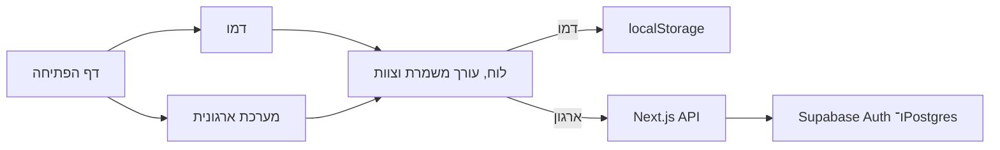

| ספרייה | אחריות |
| --- | --- |
| [src/app](src/app) | דפים, כניסה ונתיבי API של Next.js |
| [src/components](src/components) | הלוח, עורך המשמרת, זמינות, התראות ומסכי ניהול |
| [src/lib](src/lib) | מודל הדמו, מתכנן הסידור, כללי זמינות, שינויים וקבצים |
| [supabase/migrations](supabase/migrations) | סכמת המסד, RLS ופעולות אטומיות לשינוי ופרסום |
| [tests](tests) · [e2e](e2e) | בדיקות לוגיקה, Postgres מקומי וזרימות בדפדפן |

```sh
npm run lint
npm run typecheck
npm test
npm run build
npx playwright install chromium
npm run test:e2e
npm run test:e2e:flows
```

בדיקות הדמו משתמשות בבנייה המקומית בפורט 3000, בשרת שכבר רץ שם או בכתובת שהוגדרה ב־`E2E_BASE_URL`. בדיקות הארגון מפעילות שרת בפורט 3002 ומסד PGlite מקומי בפורט 4001. שתי החבילות ניתנות להרצה עם נתוני בדיקה מקומיים.
