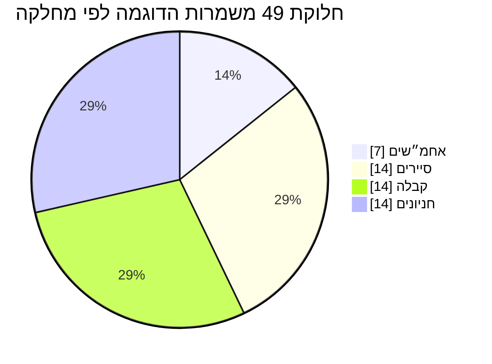
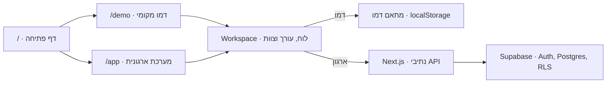
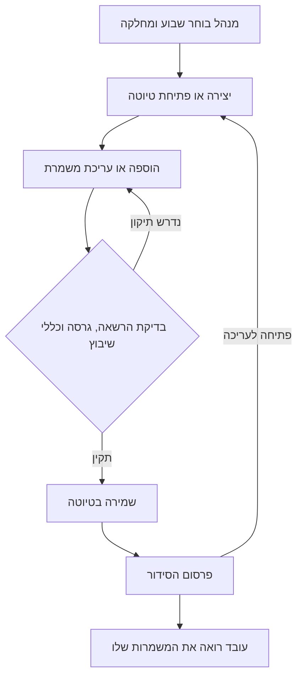

# MyShift · מדריך הרצה ושימוש

מערכת ניהול משמרות בעברית ובכיוון RTL. מנהלים מתכננים לוח שבועי לפי מחלקה, משבצים עובדים ומפרסמים את הסידור. עובדים רואים את המשמרות האישיות שפורסמו ויכולים לדווח על זמינות ועל היעדרויות.

[התחלה מהירה](#quick-start) · [מדריך שימוש](#workflow) · [צילומי מסך](#screenshots) · [חיבור ארגון](#organization) · [ארכיטקטורה](#architecture) · [בדיקות](#checks)


<a id="quick-start"></a>

## התחלה מהירה

נדרשים Git, ‏Node.js 24 ו־npm 11. משכפלים את המאגר ומפעילים את שרת הפיתוח.

```sh
git clone https://github.com/Benjamin-1Fisher/MyShift.git
cd MyShift
npm ci
npm run dev
```

| כתובת מקומית | מה רואים |
| --- | --- |
| [http://localhost:3000/](http://localhost:3000/) | דף הפתיחה עם תצוגה מקדימה וקישורים לדמו ולארגון |
| [http://localhost:3000/demo](http://localhost:3000/demo) | סביבת תרגול מלאה עם ארבע מחלקות, 12 עובדים ושני אתרים |
| [http://localhost:3000/app](http://localhost:3000/app) | כניסה לארגון המחובר ל־Supabase |
| [http://localhost:3000/setup](http://localhost:3000/setup) | מדריך חיבור הארגון מתוך האתר |

אפשר להתחיל מיד ב־`/demo`, ללא חשבון או משתני סביבה. השינויים נשמרים בדפדפן שבו בוצעו באמצעות `localStorage`. אם פורט 3000 תפוס, פתחו את הכתובת שהשרת מדפיס במסוף.

<a id="workflow"></a>

## שימוש יומיומי

### תרגול ראשון כמנהל

1. היכנסו לדמו ובחרו **מנהל** בפס הדמו בראש הדף. במסך **סידור עבודה** אפשר לעבור שבוע, לסנן לפי מחלקה או לראות רק משמרות פנויות ושיבוצים שדורשים בדיקה. בטלפון בוחרים גם יום.
2. לחצו **פנויות לשיבוץ**, פתחו את המשמרת הפנויה בסיירים ובחרו עובד זמין. לחצו **שמירה**. אפשר לבטל את הפעולה האחרונה מההודעה שמופיעה אחרי השמירה.
3. לחצו **תכנון שבועי** בלוח ובחרו מחלקה כדי לראות הצעה להוספת משמרות ולמילוי משמרות פנויות לשבוע הנבחר. השיבוץ מתחשב בזמינות, בהכשרות ובחפיפות. לחצו **אישור ושמירה כטיוטה** כדי להחיל את ההצעה. השיבוצים הקיימים נשמרים ופרסום לעובדים מתבצע בנפרד.
4. לחצו **פרסום סידור** כשהטיוטה מוכנה. כדי לשנות סידור שפורסם, לחצו **פתיחה לעריכה**, ערכו את המשמרות ופרסמו מחדש.

לחצו על שם מחלקה בלוח כדי להוסיף לה משמרת ידנית או לנהל את הטיוטה שלה. **חזרה לכל המחלקות** מחזירה ליום, לסינון ולמיקום הקודם בלוח. תאריך, שעות, אתר ותפקיד נמצאים תחת **פרטי משמרת** בעורך. פעולות שכפול ומחיקה נמצאות לצד השמירה. תפריט **עוד** בסידור המחלקה כולל העתקה, שחזור, ייבוא CSV או XLSX וייצוא Excel. בלוח הראשי אפשר להדפיס את השבוע או לשמור אותו כ־PDF ישירות מכפתור ההדפסה.

### צפייה כעובד וניהול צוות

- **עובד בדמו** בוחר את שמו בפס הדמו. ב־**המשמרות שלי** מופיעים השיבוצים האישיים שפורסמו. כדי לראות פרסום לדוגמה בלי לפרסם בעצמכם, בחרו בדניאל לוי ועברו שבוע אחד אחורה בדמו חדש.
- **הפרופיל שלי** מרכז דיווחי זמינות והיעדרויות. בסביבת הארגון הגישה נקבעת לפי החשבון וההרשאות שלו.
- **צוות** כולל חיפוש עובדים וסינון לפי מחלקה, תפקיד, מיקום והיעדרות בשבוע הנבחר. מכרטיס עובד אפשר לנהל הכשרות, זמינות והיעדרויות. בדמו מופיעים כאן גם תלושים ותזכורות לתרגול.
- **הגדרות** כוללות מבנה ארגון, אתרים, תבניות שעות, דרישות איוש ויומן פעילות. אפשר לסנן את דרישות האיוש של מחלקה לפי יום, אתר ותפקיד. **התראות** נפתחות מהפעמון.

<a id="screenshots"></a>

## צילומי מסך

| הלוח בטלפון | עריכת משמרת | תצוגת עובד |
| :---: | :---: | :---: |
|  |  |  |

[סידור מחלקה בטלפון](docs/screenshots/department-mobile.png) · [צוות בטלפון](docs/screenshots/team-mobile.png) · [הגדרות בטלפון](docs/screenshots/settings-mobile.png) · [תלושים ותזכורות](docs/screenshots/team-desk.png) · [דף הפתיחה במחשב](docs/screenshots/home-schedule-desktop.png) · [דף הפתיחה בטלפון](docs/screenshots/home-schedule-mobile.png)

### משמרות בשבוע הראשון בדמו

הגרף מתאר דמו חדש. 48 משמרות משובצות ומשמרת אחת בסיירים פתוחה לתרגול.



<a id="organization"></a>

## חיבור ארגון ל־Supabase

1. העתיקו את [קובץ ההגדרות לדוגמה](.env.example) באמצעות `cp .env.example .env.local`. הגדירו את `NEXT_PUBLIC_SUPABASE_URL` ואת `NEXT_PUBLIC_SUPABASE_ANON_KEY` עם כתובת הפרויקט והמפתח הציבורי שלו.
2. הריצו את [המיגרציות](supabase/migrations) לפי הסדר, מ־001 עד 009. אפשר להוסיף את [נתוני ההתחלה](supabase/seed.sql) אם נדרשות מחלקות ותבניות לדוגמה.
3. צרו משתמש ב־Supabase Auth והגדירו אותו כמנהל ראשי ב־SQL Editor. החליפו את הערך ב־UUID של המשתמש שיצרתם.

   ```sql
   update public.profiles
   set role = 'admin', name = 'מנהל מערכת'
   where id = 'UUID-OF-THE-CREATED-AUTH-USER';
   ```

4. הפעילו מחדש את שרת הפיתוח והיכנסו ל־[מערכת הארגון](http://localhost:3000/app). אם הארגון ריק, הגדירו את האתר הראשון והמשיכו להגדרת מחלקות, עובדים ותבניות.

מנהל ראשי מנהל שיוכים והרשאות. מנהל מחלקה פועל במחלקות שהוקצו לו. עובדים רואים את השיבוצים האישיים שפורסמו. Supabase Auth מזהה את המשתמש, ומדיניות RLS ופעולות המסד אוכפות את ההרשאות.

### פריסה ב־Vercel

ייבאו את המאגר כפרויקט Next.js והגדירו Node.js 24. פקודות ההתקנה והבנייה מוגדרות ב־[vercel.json](vercel.json). הוסיפו את משתני Supabase בסביבות הפריסה הרצויות והגדירו ב־Supabase Auth את כתובת האתר ואת כתובות ההפניה המתאימות.

לאחר החיבור, בדקו כניסה לפי תפקיד, יצירה ופרסום של סידור, דחיית חפיפות ושמירת השינויים מדפדפן נוסף.

<a id="architecture"></a>

## איך המערכת בנויה



אותם רכיבי ממשק משמשים את הדמו ואת סביבת הארגון. בדמו פעולות השיבוץ עוברות דרך מתאם מקומי. בסביבת הארגון השרת מאמת את החשבון ופעולות המסד בודקות הרשאות ושומרות את השינויים.



| חלק במאגר | אחריות |
| --- | --- |
| [src/app](src/app) | כתובות האתר, מסכי הכניסה ונתיבי ה־API |
| [src/components](src/components) | הלוח השבועי, סידור מחלקה, עורך המשמרת ומסכי הצוות |
| [src/lib](src/lib) | מודל הדמו, המתכנן, זמינות וייבוא או ייצוא |
| [supabase/migrations](supabase/migrations) | סכמת המסד, הרשאות ופעולות שמירה ופרסום |
| [tests](tests) · [e2e](e2e) | בדיקות יחידה, מסד ודפדפן |

<a id="checks"></a>

## בדיקות

```sh
npm run lint
npm run typecheck
npm test
npm run build
npx playwright install chromium
npm run test:e2e
npm run test:e2e:flows
```

בדיקות הדפדפן הרגילות משתמשות בבנייה מקומית ומפעילות את האתר בפורט 3000, או משתמשות בשרת שכבר רץ שם. בדיקות התהליכים הארגוניים מפעילות שרת בפורט 3002 ומסד PGlite מקומי לבדיקה בפורט 4001. בשני המסלולים אפשר להריץ בדיקות ללא חיבור למסד הארגון.
